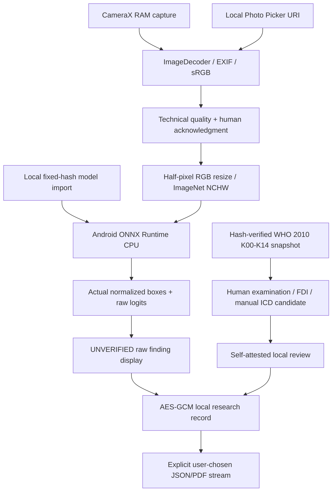

# Offline architecture and evidence boundaries

There is no network client, remote fallback, web view, Firebase dependency or model download service. Internet access by the build host, Android OS or the user's file-provider app is separate from the installed application's permission contract. No recurring inference-server resource is provisioned. Phone/storage/electricity and optional repository CI quotas are not represented as free hardware.

`export-terminology.ts` explicitly converts existing TypeScript catalog + evidence workflows to the bundled JSON. `--check` detects drift. SHA-256 is verified at app startup. Native Kotlin models do not claim to be Firebase record IDs or accept patient identifiers; no migration or synchronization to existing patient stores is implemented.

`ImagePipeline` limits input to 25 MB and 16 million pixels, handles EXIF through Android ImageDecoder and rejects alpha. It does not silently downsample decoded images. At the upper limit a bitmap and pixel-array alone can exceed 128 MB; supported phone limits are unmeasured. Quality checks describe brightness, contrast and Laplacian variance only. Camera preview is lifecycle bound and capture does not create an output file.

`LocalModel` validates exact byte size/hash on import and every analysis, replacing atomically only after validation. The model file is sandbox-local and excluded from backup; it contains weights, not patient images. Permission evidence is a local owner statement, never independent legal verification.

`OnDeviceEngine` creates a fresh CPU session per analysis, verifies input/output node names/types/shapes, executes the exact FP32 model and closes all native session/tensor/result resources. Thread count is bounded at two intra-op / one inter-op. Cancellation terminates active ORT runs and generation checks prevent late results entering another case or locked workspace. No foreground service or indefinite background task is used. Session recreation favors bounded lifetime and clean recovery; session-load time is included in reported analysis totals. Total includes model hash/load/preprocess/run/decode, excluding earlier image import/decode and subsequent UI drawing.

`DetrMath` ports the existing Python CPU adapter's preprocessing/postprocessing, preserves every model class slot and does not add assumed background/NMS/disease names. Synthetic desktop-to-Android raw tensor equivalence establishes software consistency for tested fixtures only; it does not prove correctness against the unknown original training preprocessing, class ontology or clinical labels. The first deterministic geometric fixture can produce false visual findings, which are recorded as raw results, never clinical predictions.

`SonriViewModel` separates raw findings from human forms, manual candidates and local reviews. Reviewed records lock edits; reopening adds an audit event. Results are bound to case ID and source-image hash; a historical image must be reimported identically to draw its overlay. Inference cannot confirm an ICD diagnosis. Negative findings do not set odontogram teeth healthy.

`LocalVault` authenticates encrypted records with AES-GCM, versioned AAD and atomic persistence. Keys are nonexported Android Keystore keys requiring OS-unlocked state. Activity `onStop` saves valid drafts, cancels work and clears reference-held sensitive UI state. JVM/Android memory is not claimed securely erased; OS credential gate, FLAG_SECURE and disabled backups reduce exposure without making a rooted/debug APK clinically secure. No network/logging/crash telemetry exists. PDF/JSON exports are explicitly selected, unencrypted outputs with full clinical caveats and local audit/provenance.

The separate `androidTest` package contains generic arithmetic graph bytes and synthetic input/output references. It is never shipped inside the user APK and is explicitly incompatible with the production model importer. Public CI uses this generic ORT kernel to test native loading; only private exact-checkpoint instrumentation establishes dental-model operator compatibility. Physical-phone testing and independent clinician-reviewed licensed-image benchmarking remain separate required gates.
