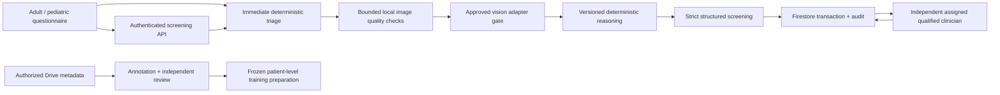

# System architecture — experimental implementation

Next.js routes authenticate Firebase ID tokens on the server. Firestore is the authoritative record store. The browser submits symptoms, patient context, consent and at most four image inputs. It cannot grant roles, reviewer credentials, dataset scopes, model approval or confirmed diagnoses.

Emergency messages are available before authentication/upload in the browser; authenticated API triage precedes decoding. No remote clinical LLM, validated detector, trained checkpoint, IoT ingestion or SATUSEHAT submission is enabled. Explanations are deterministic. This is a review candidate layered on the security repair, not a production release.

See [clinical engine](CLINICAL_ENGINE_ARCHITECTURE.md), [database](DATABASE_ARCHITECTURE.md), [limitations](CLINICAL_LIMITATIONS.md) and [release gates](DEPLOYMENT_CHECKLIST.md).
